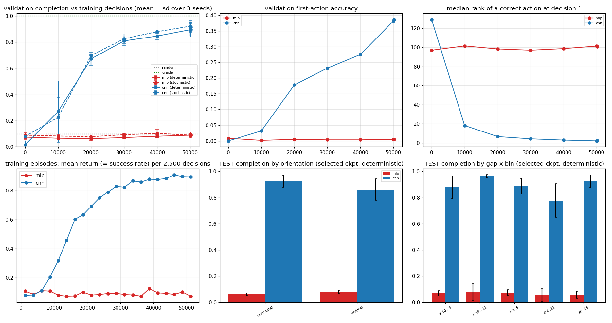

# Synthetic RL lab

Workflow: **hypothesis -> minimal synthetic experiment -> controlled comparison -> native Mini Motorways validation.** The synthetic simulator is an experimental instrument, not a replacement or an approximation of the game. Nothing here was run against the native game; no native PPO experiment was launched for this study and all earlier native experiment artifacts are untouched.

## 1. Minimal simulator (`python/synthetic_rl/`)
Models only: a 2D tile grid (the native 37 x 21 grid, x -18..18, y -10..10), one house with a driveway edge, one matching 2 x 2 destination with a carpark stub edge, road edges, legal ADD / REMOVE / WAIT, connectivity, episode termination, configurable reward and task difficulty. No Unity, IPC, traffic, spawning, animation or rendering. Pure Python + numpy.

| rule | implementation |
|---|---|
| edges | undirected, canonical `(x, y, 'E'|'S')`; `S` connects `(x,y)` and `(x,y-1)` (native: South = y-1) |
| ADD(x,y,d) legal | both endpoint tiles inside the task's reach window and free (not house / destination / carpark), edge absent, concrete > 0 |
| REMOVE(x,y,d) legal | edge exists, both endpoints free (stub edges can never be removed), and tile `(x,y)` has exactly ONE road edge (the native rule: ClearTileExplicit clears a whole tile, so a single-edge removal is only offered where it equals that) |
| WAIT | always legal, except while a delayed reward is pending (then WAIT-only, like the forced upgrade choice natively) |
| upgrade slots (3109, 3110) | always illegal (no upgrades modelled) |
| connected | house start tile reaches the goal tile (the carpark stub's tile) through road edges |
| construction window | 20 decisions; SUCCESS when connected; DESTRUCTIVE FAILURE if an edge of the original network is removed; TIMEOUT (truncated) after 20 decisions |
| concrete | 25 total; the pre-built edges consume it; ADD costs 1, REMOVE refunds 1 (native accounting is more involved) |

Tasks (`generator.py`): Gap-N = a path start -> goal with N edges left out; any order of adding them completes the connection. **Solution uniqueness** is verified at generation: the minimum number of new edges to connect house and destination equals N and there is exactly one shortest edge set (counted on the contracted component graph), so no alternative or accidental solution exists. Layouts vary in window size/position anywhere on the map, house position and driveway side, destination position, carpark side and stub direction, path shape and length (N + 2 .. 14 edges), gap positions. Splits are disjoint by base layout (house, destination, path): Gap-1 2,000 / 200 / 400 (train / validation / test), Gap-2 and Gap-3 1,000 / 100 / 200, frozen in `research/synthetic_lab/manifests/` with SHA-256:

```
08a24561e309c90172694b8380375870402f42ebe390e126d27964ea6c4388a3  gap1_test.jsonl  (400 tasks, 400 base layouts)
0ef3e69f4e7ac3be2aed3054b951a494f6239828922e3da87ce8b1ebafdb5143  gap1_validation.jsonl  (200 tasks, 200 base layouts)
2883734781a17b7969614192f8ceab04aed3f10b7d0c262a2fec8ef928d68d1b  gap1_train.jsonl  (2000 tasks, 2000 base layouts)
```

## 2. Interface mapping (inspected from the real implementation, not hard-coded)
Sources: `python/mini_motorways_env.py` (`NUM_TILE_FEATURES = 15`, `NUM_GLOBAL_FEATURES = 11`, `_ROAD_STATE_ORDINAL`, `_CONTENT_TYPE_ORDINAL`, `encode_observation`) and `Entrypoint.cs` (`ActionIndexToDescriptor` / `DescriptorToActionIndex`, observation bounds = action bounds = xMin -18, yMin -10, 37 x 21). `layout.py` **derives** the sizes: observation = 37*21*15 + 11 = **11,666**, actions = 1 + 37*21*4 + 2 upgrade slots = **3,111**; both asserted in the tests.

* Observation: tiles row-major (y outer, x inner), 15 features each, then 11 globals - identical layout, so the same flat vector feeds MLPs and the CNN's tile-tensor reshape (15, 21, 37).
* Actions: 0 = WAIT; `1 + tile*4 + dir*2 + kind` with dir E=0 / S=1 and kind ADD=0 / REMOVE=1; the two upgrade slots follow. Gymnasium API, `action_masks()` (MaskablePPO convention), `reset(options={'task_index'})`, `info['appliedAction' / 'accepted' / 'rewardComponents']` as the native env.
* Feature table (verified, see check 9; fields the sandbox does not model carry the neutral value 0 - **no fake gameplay signals**):

| native feature | synthetic value |
|---|---|
| 0 buildable | 1 on every tile (neutral: no terrain) |
| 1-3 water / mountain / rail | 0 |
| 4-7 road N/E/S/W | Active/3 = 0.667 on live edges (both endpoint tiles), else 0 |
| 8-9 traffic light / roundabout | 0 |
| 10 content | House 0.5; Destination 1.0 (4 footprint tiles); the carpark tile is content 0 exactly as natively (the native encoder maps unknown content types, incl. Carpark, to 0) |
| 11 group flag | 1 on house and destination tiles |
| 12-14 demand, overcrowding, vehicles | 0 |
| globals | hour = 1.2 t mod 24 (/24), day, week 0, score/1000, concrete ratio; other resource ratios and pending upgrades 0 |

## 3. Validation before any training

| # | check | result |
|---|---|---|
| 1 | 1_oracle_completes_every_generated_task | PASS - 5200/5200 tasks (Gap-1/2/3, train+validation+test); oracle uses exactly N actions (max steps 3) |
| 2 | 2_random_policy_substantially_worse_than_oracle | PASS - random-legal completion on TEST: {'gap1': 0.1125, 'gap2': 0.01, 'gap3': 0.0} (oracle 1.0) |
| 3 | 3_every_intended_correct_action_is_legal | PASS - 0 violations over all tasks; legal actions per state: mean 202, min 128, max 287 (native Gap-1 starts: mean 151) |
| 4 | 4_observation_and_action_mappings_consistent | PASS - synthetic obs == real encode_observation(native-style dict) in 120/120 states; action index<->descriptor bijection over all 3111 indices: True; derived sizes obs 11666, actions 3111 |
| 5 | 5_rewards_and_termination_semantics | PASS - WAIT=0, completion +1 & terminates, wrong ADD=0, destructive terminates with 0, timeout truncates at 20, delayed reward arrives 12 WAIT steps after connecting and terminates, native-like stream delivers 3 sparse +1; prob |
| 6 | 6_train_and_test_layouts_disjoint | PASS - overlaps=[] (checked base layouts and full configurations for Gap-1/2/3) |
| 7 | 7_no_correct_action_labels_in_observation | PASS - obs unchanged when the stored solution is overwritten: True; shape (11666,) (native-identical); the solution only exists in env.task/info metadata |
| 8 | 8_observation_contains_enough_information | PASS - a solver that sees ONLY the observation vector + legal mask (component contraction + BFS) solves 800/800 test tasks (Gap-1/2/3) |
| 9 | 9_synthetic_to_native_adapter_has_explicit_tested_mappings | PASS - mapping table below verified against the real encode_observation (check 4); neutral fields asserted constant: {"buildable (0)": "1 on every tile (neutral; no terrain modelled)", "water/mountain/rail (1-3)": "0 (not model |
| 10 | 10_throughput_without_the_game | PASS - 9001 env steps/s (single process, random legal actions incl. mask + 11,666-float observation per step); native game ~4-5 steps/s |

Informational: 255/300 Gap-1 tasks are solvable from the observation alone when roads are allowed to pass beside the destination (when roads may pass beside the destination, the carpark is not identifiable from the native-compatible observation).

All checks run via `python -m synthetic_rl.tests`; results in `research/synthetic_lab/validation_results.json`.

**A finding about the native interface** (made while debugging check 8): the native observation encodes the carpark tile as content 0 (`_CONTENT_TYPE_ORDINAL.get(...)` default), so a road that merely passes beside a destination is indistinguishable from its real entry. With unconstrained layouts an observation-only solver solves only ~85% of Gap-1 tasks. The sandbox generator therefore keeps every other road tile off the destination's neighbourhood so the task is inferable; the native game does not provide that guarantee. This is a representation question worth testing natively.

### Hand-inspectable example
```
HAND-INSPECTABLE EXAMPLE (Gap-1, test task syn_gap1_test_000004)
window (reach) x=-14..-4 y=-3..5 ; H=house tile, D=destination footprint, C=carpark, '+'=road tile
y=  5 . . . . . . . . . . .
                           
y=  4 . . . . . . . . . . .
                           
y=  3 . . . . . . . . . . .
                           
y=  2 . . . . . . . . . . .
                           
y=  1 . . . D D . . . +-+ .
                      | |  
y=  0 . . . D D C-+ +-+ H .
                           
y= -1 . . . . . . . . . . .
                           
y= -2 . . . . . . . . . . .
                           
y= -3 . . . . . . . . . . .
      x=-14..-4
house [-5, 0] driveway N -> start tile [-5, 1];  carpark [-9, 0] stub E -> goal tile [-8, 0]
path (4 edges, 1 left out): (-5,1) (-6,1) (-6,0) (-7,0) (-8,0)
missing edge: ADD_ROAD(-8,0,E) = action index 1521  (decode -> ('ADD', -8, 0, 'E')); legal now: True
legal actions: 158 of 3111 (WAIT, 156 ADD, 1 REMOVE)
non-zero observation features around the gap (tile: feature=value):
  tile (-8,0) idx 380: {0: 1.0, 7: 0.667}   [4..7 = road N/E/S/W, 10 = content, 11 = group flag]
  tile (-7,0) idx 381: {0: 1.0, 5: 0.667}   [4..7 = road N/E/S/W, 10 = content, 11 = group flag]
after ADD_ROAD(-8,0,E): reward 1.0, terminated True, connected True
y=  5 . . . . . . . . . . .
                           
y=  4 . . . . . . . . . . .
                           
y=  3 . . . . . . . . . . .
                           
y=  2 . . . . . . . . . . .
                           
y=  1 . . . D D . . . +-+ .
                      | |  
y=  0 . . . D D C-+-+-+ H .
                           
y= -1 . . . . . . . . . . .
                           
y= -2 . . . . . . . . . . .
                           
y= -3 . . . . . . . . . . .
      x=-14..-4

```

## 4. Hypotheses and falsification criteria
| id | hypothesis | experiment (one variable at a time) | falsified if |
|---|---|---|---|
| H1 | a flat MLP cannot learn location-invariant gap completion; a spatial CNN can | S1: MLP vs spatial CNN, Gap-1, completion reward, native-compatible 3,111 actions | the CNN does not beat the MLP / random on held-out layouts at equal budget and seeds, or the CNN's gain is explained by memorised action indices |
| H2 | the large global action space makes exploration inefficient | native-compatible vs compact task-local action space (diagnostic control only) | the compact space gives no improvement to the architecture that already learns |
| H3 | delayed / sparse reward blocks learning | immediate +1 vs +1 after a WAIT continuation vs a native-like sparse stream (implemented in the env: `reward_mode`) | learning curves are indistinguishable across reward timing |
| H4 | multi-step construction is harder than one edit | Gap-1 vs Gap-2 vs Gap-N (manifests generated) | completion does not fall with N / policies that solve N=1 solve N=2 zero-shot |

Only S1 was run (as instructed). Success criteria for S1: held-out completion clearly above RANDOM at equal budget in >= 3 of 3 seeds, first-action/rank evidence of targeting (not WAIT/ADD frequency), and success on tasks whose correct action index never appears in training.

## 5. Experimental configuration (S1)
`experiments/configs/synthetic_s1_{mlp,cnn}_s{11,12,13}.yaml` run through `python -m experiments.synthetic_run --config ...` (harness: immutable run directory, resolved config, metadata with source and library hashes, checkpoint index with SHA-256, per-episode / training CSVs, validation per checkpoint, checkpoint selection on VALIDATION only, one TEST evaluation of the selected checkpoint).
* Task: synthetic Gap-1, reward = +1 on the connecting transition (episode terminates), 20-decision construction window, 3,111-action native-compatible space with native-style masks.
* Algorithm: MaskablePPO with the hyperparameters of the frozen native Baseline-0 (n_steps 512, batch 256, 4 epochs, target_kl 0.03, gamma 0.99, lr 3e-4, ent_coef 0.01, gae_lambda 0.95, clip 0.2). Budget: 50,000 decisions per run (a short pilot), checkpoints every 10k plus step 0; 3 training seeds (11, 12, 13) per architecture, identical across architectures.
* Flat MLP: SB3 `MlpPolicy` (64-64) on the 11,666-vector, as used natively. Spatial CNN: `synthetic_rl/models.py::SpatialMaskablePolicy` - the same 11,666 observation is reshaped to (15, 21, 37) + 11 globals; three 3x3 convolutions at full resolution, a 1x1 per-tile head producing the four native logits per tile (E-add, E-remove, S-add, S-remove) laid out exactly as action indices 1..3108, WAIT and the two upgrade slots from a pooled-features + globals branch; the native legal mask is applied by MaskablePPO. 73,416 parameters (the MLP has 1.7 M). The class depends only on the documented observation/action layout, so it can be plugged into the native training stack unchanged (architecture transfer); learned weights are not claimed to transfer.
* Runs: `2026-10-08_140406_syn_s1_cnn_s11`, `2026-10-08_140406_syn_s1_cnn_s12`, `2026-10-08_140406_syn_s1_cnn_s13`, `2026-10-08_140406_syn_s1_mlp_s11`, `2026-10-08_140406_syn_s1_mlp_s12`, `2026-10-08_140406_syn_s1_mlp_s13`

## 6. Throughput

| measurement (single process, otherwise idle CPU) | steps / second |
|---|---|
| env only, random legal action | 4,170 |
| env only, oracle action | 3,362 |
| env + flat MLP policy inference (batch 1) | 575 |
| env + spatial CNN policy inference (batch 1) | 240 |
| PPO training, flat MLP (512x4 epochs) | 227 |
| PPO training, spatial CNN (512x4 epochs) | 55 |

The validation suite measured about 9,000-10,000 env steps/s for random-legal stepping on a quieter moment; the benchmark above (4,170) is the slower, later reading - the spread is CPU variance, not a different code path. Training throughput inside PPO is dominated by the policy network: the MLP trains at ~230 steps/s and the CNN at ~55 steps/s alone (96 and 30 steps/s per process with six processes sharing the CPU), versus ~4-5 steps/s for the native game. A 50k-decision pilot took 9 min (MLP) / 28 min (CNN) here versus roughly 3 hours natively.

## 7. S1 results

### S1 results (3 training seeds per architecture; synthetic Gap-1, immediate completion reward, native-compatible 3,111-action space)

Held-out TEST (400 unseen layouts), checkpoint SELECTED on VALIDATION only (deterministic policy unless stated); mean ± sd across seeds.

| policy | test completion | first-action accuracy | median steps | destructive | timeout | WAIT / ADD / REMOVE | P(correct) at decision 1 | median rank of correct action |
|---|---|---|---|---|---|---|---|---|
| WAIT | 0.0% | 0.0% | None | 0.0% | 100.0% | 100 / 0 / 0 % | - | - |
| RANDOM | 9.3% | 0.5% | 10 | 11.1% | 79.6% | 1 / 91 / 8 % | - | - |
| ORACLE | 100.0% | 100.0% | 1.0 | 0.0% | 0.0% | 0 / 100 / 0 % | - | - |
| flat MLP (selected ckpt, deterministic) | 6.8% ± 0.3 | 0.2% ± 0.0 | [7.0, 11.0, 8.5] | 9.9% ± 4.7 | 83.2% ± 4.4 | 6 / 83 / 11 % | 0.0046 | 99.3 |
| flat MLP (selected ckpt, stochastic) | 9.1% ± 1.2 | 0.8% ± 0.0 | [7.0, 9, 12.5] | 14.4% ± 2.7 | 76.5% ± 1.7 | 1 / 91 / 8 % | 0.0046 | 99.3 |
| flat MLP (final ckpt, deterministic) | 7.7% ± 0.8 | 0.4% ± 0.3 | [6.0, 11.0, 8.5] | 10.2% ± 2.2 | 82.1% ± 3.0 | 0 / 83 / 17 % | 0.0048 | 98.0 |
| spatial CNN (selected ckpt, deterministic) | 89.8% ± 6.1 | 39.6% ± 4.7 | [2.0, 2, 2] | 0.6% ± 1.0 | 9.6% ± 6.3 | 5 / 94 / 1 % | 0.2533 | 2.7 |
| spatial CNN (selected ckpt, stochastic) | 90.5% ± 2.6 | 25.9% ± 1.9 | [3, 3, 3.0] | 0.5% ± 0.9 | 9.0% ± 2.4 | 5 / 94 / 1 % | 0.2533 | 2.7 |
| spatial CNN (final ckpt, deterministic) | 89.2% ± 6.9 | 39.6% ± 4.7 | [2.0, 2, 2] | 1.1% ± 1.9 | 9.7% ± 7.3 | 5 / 94 / 1 % | 0.2530 | 2.3 |

Per-seed TEST completion (selected checkpoint, deterministic): MLP [0.07, 0.07, 0.065], CNN [0.835, 0.902, 0.958].

### Validation completion by training step (200 validation layouts; mean ± sd over seeds)

| decisions | MLP det. | MLP stoch. | CNN det. | CNN stoch. |
|---|---|---|---|---|
| 0 | 7.5% ± 1.8 | 9.0% ± 1.8 | 1.7% ± 2.9 | 8.0% ± 1.8 |
| 10000 | 6.7% ± 1.2 | 8.3% ± 1.0 | 27.0% ± 23.4 | 22.7% ± 15.3 |
| 20000 | 6.3% ± 1.3 | 7.8% ± 1.2 | 67.3% ± 4.9 | 69.8% ± 0.6 |
| 30000 | 7.2% ± 0.8 | 9.3% ± 0.8 | 81.0% ± 3.8 | 82.7% ± 3.6 |
| 40000 | 8.2% ± 1.2 | 10.3% ± 3.0 | 84.7% ± 2.8 | 88.0% ± 1.3 |
| 50000 | 9.0% ± 1.3 | 9.0% ± 0.0 | 89.5% ± 4.8 | 92.2% ± 4.6 |
| 50176 | 9.2% ± 2.1 | 8.7% ± 0.8 | 89.7% ± 5.5 | 91.5% ± 3.5 |

Validation baselines: WAIT 0.0%, RANDOM LEGAL 9.8% (5 seeds), ORACLE 100%.

### Cost
| architecture | parameters | training SPS (per process, 6 processes in parallel) | wall-clock for 50k decisions | native game reference |
|---|---|---|---|---|
| mlp | 1,703,976 | 96 | 8.7 min | native ~4-5 SPS (about 3 h per 50k) |
| cnn | 73,416 | 30 | 27.7 min | native ~4-5 SPS (about 3 h per 50k) |

### Memorisation checks (TEST)

- Most common correct-action index covers 0.8% of test tasks, so repeating one index cannot exceed that.
- mlp: tasks whose correct action index never occurs in TRAIN: n=70; completion on them per seed [0.114, 0.071, 0.029]
- cnn: tasks whose correct action index never occurs in TRAIN: n=70; completion on them per seed [0.814, 0.857, 0.943]



Top row: validation completion vs training decisions, first-action accuracy, median rank of a correct action at decision 1. Bottom row: training-episode success, TEST completion by gap orientation and by gap x-position (selected checkpoint).

## 8. Reading the S1 result

* **H1 is supported in this sandbox.** At the same budget, seeds, tasks, reward and action space, the flat MLP stays at the random level (6.8% on TEST vs 9.3% for RANDOM) with no upward trend, while the spatial CNN reaches 89.8% +- 6.1 (per seed 83.5 / 90.2 / 95.8%) on 400 unseen layouts. The MLP failure reproduces the native-game failure in minutes instead of hours, and it happens with an immediate +1 reward, so reward delay is not needed to explain it.
* **Not memorisation:** the most common correct-action index covers 0.8% of test tasks; on the 70 TEST tasks whose correct action index never occurs in TRAIN the CNN still completes 81-94% (MLP 3-11%). CNN TEST completion by orientation: horizontal 92% (n=235), vertical 86% (n=165); by gap x-position 88-96% in all bins with n >= 46 (78% in the far-right bin, n=12); it falls mildly with path length (95% at 3-5 edges to 83% at 12-14). The MLP is flat at 6-8% in every group.
* **The CNN is targeting but not exact:** first-action accuracy is only about 40% (P(correct) at decision 1 about 0.25, median rank 2-3) - it narrows 3,000 actions to a handful of plausible gap candidates and, because wrong additions are free inside the 20-decision window, tries them in turn (median 2 decisions to completion, destructive failures <= 2%, ADD fraction 94%). A stricter protocol (penalised wrong roads or a one-shot budget) would score it differently; that was deliberately not changed here.
* **Variance:** seeds differ by about +-6 points on TEST; 3 seeds support the qualitative MLP-vs-CNN conclusion, not a precise accuracy.
* **Cost:** the CNN has 23 times fewer parameters but is about 4 times slower per training step.
* **Budget caveat:** 50k decisions is a short pilot. The MLP not learning within 50k does not prove it cannot learn with more steps, a different learning rate or width; it shows it is much less sample-efficient on this task. The CNN curve (65% at 20k, ~85% at 40k) was still rising at 50k for two seeds.

## 9. Limitations

* The sandbox is a toy: one house-destination pair on a flat grid, no terrain, traffic, vehicles, demand, overcrowding, bridges or tunnels, no weekly upgrades, no time pressure, always-Active roads (no Pending / Mothballed states), a single connection colour.
* Legality is an approximation of the native rules: reach window per task, REMOVE offered only on single-edge tiles, simplified concrete accounting. Legal action counts differ (synthetic mean 202, native Gap-1 starts mean 151); the agreement between synthetic and native masks was **not** measured.
* The observation mapping was tested against the real `encode_observation` function fed with native-style field names, **not against live observations from the running game**; a live roundtrip comparison is a prerequisite for native transfer claims.
* Task generator constraint (carpark identifiable from the observation) makes the sandbox easier than the native game in one respect (see section 3).
* S1 is a 50k-decision pilot with 3 seeds per architecture; no hyperparameter tuning for either architecture; deterministic and stochastic policy results are both reported.
* Gap completion is scored within a free-retry construction window; first-action accuracy is reported separately.
* H2, H3, H4 were not run; the environment supports them (`reward_mode` delayed / native_like, Gap-2/3 manifests) but no results exist.
* Findings about architectures transfer as hypotheses, not weights.

## 10. What justifies native validation

Supported by S1 and cheap to check natively: a **native Gap-1 run of the spatial CNN policy** (architecture transfer; the policy class is already compatible with the native observation/action layout) with the same frozen native manifests and the native completion-reward task, compared with the flat MLP at an equal budget. Before that, a one-off live roundtrip check of the synthetic adapter against real game observations and a measurement of mask agreement. Not justified yet: claims about delayed reward (H3), action-space size (H2) or multi-step construction (H4) - run those synthetically first, one variable at a time.

## 11. Reproduction

```
python -m synthetic_rl.make_tasks --n-gaps 1            # frozen manifests (also --n-gaps 2/3)
python -m synthetic_rl.tests                              # 10 validation checks + hand example
python -m synthetic_rl.bench                              # throughput
python -m experiments.synthetic_run --config experiments/configs/synthetic_s1_cnn_s11.yaml
python experiments/synthetic_s1_report.py                 # tables + figure
```
Artifacts: `research/synthetic_lab/` (manifests, validation_results.json, hand_example.txt, throughput_benchmark.json, s1_results_section.md, s1_mlp_vs_cnn.png), run directories under `runs/`.

