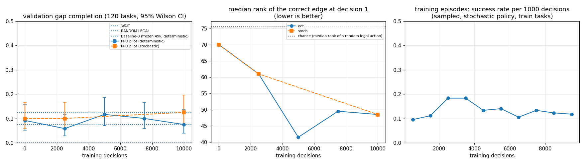

# Gap-1 immediate-reward (binary completion) diagnostic — 10k-decision pilot

Scope: one training seed, ~10k decisions, flat MLP + MaskablePPO (Baseline-0 hyperparameters), reward = 1.0 only on the transition that completes the connection. Evaluated on the frozen VALIDATION set only; the held-out TEST set was not touched. This is a pilot, not a result about the Gap-1 task in general.

## Experiment A status
Experiment A (native reward, 3 seeds) was **stopped on request as an incomplete native-reward pilot, not a completed negative result**: seeds 101 / 102 / 103 reached 5,632 / 5,632 / 7,168 of the planned 100,000 decisions; no checkpoints were produced (first due at 20k). An earlier launch of the same three runs (4–5k steps each) was lost when the controlling session ended and is marked aborted. Metrics are preserved in `runs/2026-10-08_1048*gap1_native_s10*` and summarised in `experiment_A_incomplete_pilot_summary.json`. Baseline-0 files were not modified.

## Task as used
Frozen Gap-1 manifests (train 600 / validation 120 / test 240; no shared layouts or seeds). Episode = the unchanged native game started in CONNECTED_START with one path edit left out. Reward `1.0` iff the target house becomes connected to the target destination (native live road graph) on that transition, else `0.0`; no native score, no terminal penalty, no shaping, no penalties. Episode ends on: success (`terminated`), destructive failure (`terminated`), native terminal (`terminated`), or 20 decisions without success (`truncated`). PolicyObservation (11,666 floats) and the discrete action space (3,111 actions, native masks) are unchanged (your brief quoted 11,665 / 1,025; those are not the live values and nothing about them was changed).

## Test suite (run before any training)
| # | check | result |
|---|---|---|
| 1 | 1_correct_action_reward1_terminates | PASS — 10 tasks; failures=[] |
| 2 | 2_incorrect_legal_road_gives_0 | PASS — 10 tasks; failures=[] |
| 3 | 3_wait_gives_0 | PASS — 10 tasks; failures=[] |
| 4 | 4_destructive_action_zero_and_terminates | PASS — 8 destructive removals tested; failures=[] |
| 5 | 5_timeout_zero_and_truncates_at_20 | PASS — 5 tasks; failures=[] |
| 6 | 6_no_native_reward_or_terminal_penalty | PASS — leaks=[]; live reward values over 30 random episodes=[0.0, 1.0] |
| 8 | 8_observation_is_the_unchanged_policy_observation | PASS — obs shape (11666,); equals encode_observation(native observation): True; task fields only in info: ['task_id', 'task_index'] |
| 9 | 9_layouts_and_correct_action_vary | FAIL — 20 live resets: 9 distinct houses, 18 distinct a*, orientations ['horizontal', 'vertical']; distinct a* per split {'train': 173, 'validation': 76, 'test': 115}; top single-index share {'train': 0.025, |
| 10 | 10_identical_task_and_actions_reproduce_identical_results | PASS — 3 tasks x 2 replays; mismatching tasks=[] |

Check 9 note: in the first run (`completion_diagnostic_tests_run1.json`) check 9 reported **FAIL** because it used the first 20 manifest entries, which come from only 10 base layouts (9 distinct houses; my threshold was ≥10). It was re-run on 20 randomly sampled validation tasks (fixed seed): **PASS** — random20: 20 live resets -> 15 distinct houses, 19 base layouts, 16 distinct a*, orientations ['horizontal', 'vertical']; whole splits: distinct a* {'train': 173, 'validation': 76, 'test': 115}, base layouts {'train': 342, 'validation': 70, 'test': 125}, top single-index share {'train': 0.025, 'validation': 0.05, 'test': 0.046}. I changed the sampling, not the claim; both results are in the artifacts.

Check 7 (a* legal in the native mask, house disconnected at reset, and the real completion reward fires with termination when a* is played) was run over **all 960 configurations**:
- 7_correct_action_legal_and_rewarded_in_every_initial_state[train shard 0/2]: PASS — 300 configurations checked; failures=[]
- 7_correct_action_legal_and_rewarded_in_every_initial_state[train shard 1/2]: PASS — 300 configurations checked; failures=[]
- 7_correct_action_legal_and_rewarded_in_every_initial_state[validation,test shard 0/1]: PASS — 360 configurations checked; failures=[]

## Training configuration
- seed 301, requested 10000 decisions; SB3 stopped at **10107** (the run was resumed once by the supervisor after a game hang, see anomalies)
- PPO: {'n_steps': 512, 'batch_size': 256, 'n_epochs': 4, 'target_kl': 0.03, 'gamma': 0.99, 'learning_rate': 0.0003, 'ent_coef': 0.01, 'gae_lambda': 0.95, 'clip_range': 0.2, 'network': 'mlp'}; decision interval 1.0 s; construction window 20; headless game; deployed bootstrap DLL sha256 `7ba7147eceb1fdeed7d5d2ab01db18af155a67905550c4a3a97caf3e581d7137`; game build 25381668
- wall clock 2770 s, mean SPS 3.63; run dir `runs\2026-10-08_113610_gap1_completion_pilot`; config sha256 `3c48683912c71d28944a85dfb6138d14d7785e63f21eb2462e31dfb5b73e0c87`; source tree sha256 `0d49dce8329bc9035ff3df8b57e84c0ed39c361369b2b673e7c498e193a3081d`

### Checkpoints
| file | decisions | sha256 |
|---|---|---|
| step_000000.zip | 0 | `a2850a209e14696383155757bb0ff94f7ccdea59ea212794a6ca2cd00d7cf3d7` |
| step_002500.zip | 2500 | `9ebe802965a7480f2f94a9abcbbe811c40da4a93442155d28f0bc6497c4d50a6` |
| step_005000.zip | 5000 | `d7e927001de0fab5eb2136c9ea796495e552c96bdc6570019ad8095087f09336` |
| step_007500.zip | 7500 | `754bd0d6ac5e85164133bf689d9d9291f279fa37e891d67432f0d8333cf524d3` |
| step_010000.zip | 10000 | `a3f18ce1196646950d85895ff0a9249c90c5cdeb427d59bdf016a5eae462b4db` |
| final.zip | 10107 | `0bd247f1188912be7c0114e34c74ef29cdcd682462373f7f30b2ae524f63a4a7` |

## Validation performance by training step (120 tasks; completion within 20 decisions, 95% Wilson CI)
| policy | completion | first-action acc. | median steps | destructive | timeout | WAIT / ADD / REMOVE | mean P(a*) at decision 1 | median rank of a* |
|---|---|---|---|---|---|---|---|---|
| WAIT | 0.0% [0.0%–3.1%] | 0.0% | n/a | 0.0% | 100.0% | 100.0% / 0.0% / 0.0% | None | None |
| RANDOM LEGAL | 7.5% [4.0%–13.6%] | 0.0% | 11 | 11.7% | 80.8% | 1.0% / 91.8% / 7.2% | None | None |
| Baseline-0 (frozen 49k, deterministic) | 12.5% [7.7%–19.6%] | 1.7% | 12 | 5.8% | 81.7% | 0.0% / 91.1% / 8.9% | 0.008 | 81.5 |
| PPO pilot @ 0 — deterministic (primary) | 9.2% [5.2%–15.7%] | 0.0% | 3 | 5.0% | 85.8% | 0.0% / 66.1% / 33.9% | 0.0067 | 70.0 |
| PPO pilot @ 2500 — deterministic (primary) | 5.8% [2.9%–11.6%] | 0.0% | 7 | 24.2% | 70.0% | 0.0% / 85.6% / 14.4% | 0.007 | 61.0 |
| PPO pilot @ 5000 — deterministic (primary) | 11.7% [7.1%–18.6%] | 4.2% | 2.0 | 24.2% | 64.2% | 0.0% / 62.7% / 37.3% | 0.0078 | 41.5 |
| PPO pilot @ 7500 — deterministic (primary) | 10.0% [5.8%–16.7%] | 4.2% | 2.0 | 15.0% | 75.0% | 42.1% / 37.3% / 20.7% | 0.0086 | 49.5 |
| PPO pilot @ 10000 — deterministic (primary) | 7.5% [4.0%–13.6%] | 2.5% | 2 | 10.8% | 81.7% | 58.6% / 26.0% / 15.5% | 0.0092 | 48.5 |
| PPO pilot @ 0 — stochastic (secondary) | 10.0% [5.8%–16.7%] | 0.0% | 6.5 | 11.7% | 78.3% | 0.8% / 91.2% / 8.1% | 0.0067 | 70.0 |
| PPO pilot @ 2500 — stochastic (secondary) | 10.0% [5.8%–16.7%] | 0.8% | 5.0 | 11.7% | 78.3% | 0.7% / 91.0% / 8.3% | 0.007 | 61.0 |
| PPO pilot @ 10000 — stochastic (secondary) | 12.5% [7.7%–19.6%] | 1.7% | 5 | 13.3% | 74.2% | 2.1% / 89.2% / 8.6% | 0.0092 | 48.5 |

Not evaluated (instance hangs under load; not retried to avoid spending more compute): [(5000, 'stoch'), (7500, 'stoch')].

Reference numbers: mean number of legal actions at decision 1 = 151; a uniform policy over legal actions would give P(a*) ≈ 0.0067 and a median rank ≈ 76. RANDOM LEGAL completes 7.5% by chance (about 20 draws of a ~1% event).

## Learning curves

Left: validation completion (deterministic and stochastic) vs the three baselines. Middle: median rank the policy gives the correct edge at decision 1. Right: training-episode success rate per 1,000 decisions.

## Action distributions
See the WAIT / ADD / REMOVE column above (fractions of all decisions on validation). Untrained and 2.5k/5k policies are ADD-heavy (like RANDOM and Baseline-0); by 7.5k–10k the deterministic policy has moved to mostly WAIT (42% → 59%) with fewer ADDs. The correct-edge ADD fraction (`correct_edge_add_fraction`) and per-configuration rows are in each evaluation's `results.json` / `episodes.csv`.

## Reading of the result (descriptive only)
- Deterministic validation completion across steps: 0: 9.2%, 2500: 5.8%, 5000: 11.7%, 7500: 10.0%, 10000: 7.5%. All values lie within the sampling noise of RANDOM LEGAL (7.5%) with n = 120 (CIs span ±4–5 points); the untrained policy scores the same as the trained ones. There is no evidence of learning to complete the gap in 10k decisions.
- The probability the policy assigns to the correct edge at decision 1 (mean 0.0067 untrained → 0.0092 at 10k) starts exactly at the uniform level (0.0067) and ends at 1.4x uniform, a weak but present trend; its median rank moved from 70.0 to 48.5 of ~151 legal moves, a small shift (mean top-5 share 5.8% → 13.3%) that has not translated into completions.
- The training-episode success rate (right panel) is flat at the random level. With one seed, 10k decisions and ~1% per-decision chance of hitting the right edge, only 77 successful training episodes out of 583 (the reward events) were available as a learning signal; the pilot cannot distinguish 'the MLP cannot represent the edge' from 'exploration is too sparse'.
- The pilot does **not** show the policy is worse than RANDOM; it is statistically level with RANDOM and Baseline-0 on validation.

## Anomalies
- One game hang mid-training (`No IPC response ... RESET`, ~9.6k decisions): the supervisor relaunched the game and resumed. This surfaced a bug in `python/train_ppo.py`'s supervisor (after a restart it re-requested the *full* budget, overshooting; observed earlier as a 122,880-step run reaching 144k). It now requests only the remaining decisions; the first launch path is unchanged. Final step count here is 10,107, not a multiple of 512, for this reason.
- Validation evaluations hang when many game instances run at once (a first attempt with ten parallel instances mostly failed; superseded runs are marked `failed_*` in their metadata). The evaluator restarts the game every 60 configurations and on IPC errors and resumes from saved rows; successful evaluations are complete (120/120).
- Checkpoints are at 0, 2,500, 5,000, 7,500, 10,000 decisions (+ final at 10,107); `final.zip` was not evaluated separately from `step_010000`.
- Stochastic validation at 5,000 and 7,500 missing (see above).
- Unrelated to the experiment: the earlier native pilot's throughput was ~4–5 SPS with three parallel runs; this single-seed pilot ran at ~3.7 SPS including one restart.

## Decision requested
Per the stop rule (completion remains near RANDOM), no further training was started. Nothing else was launched: no longer training, architecture change, reward experiment, Gap-2 or extra probe.
